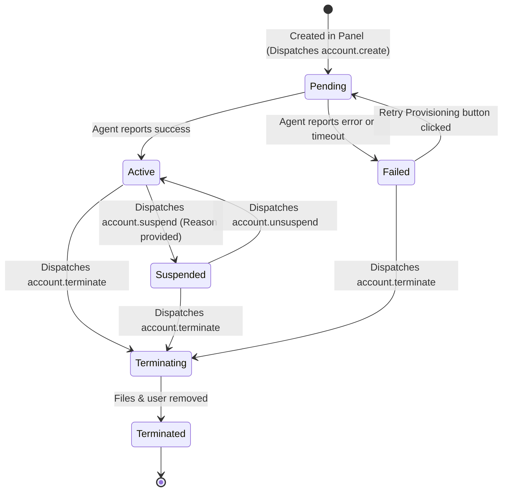

# Account Provisioning Architecture & Manual Testing Guide

This document describes the hosting account lifecycle, state machine transitions, agent actions, security isolation models, and step-by-step procedures for manual verification on target servers (Ubuntu 24.04 / Debian 12).

---

## 1. Hosting Account State Machine



### Transition Guards

| Current Status | Allowed Target Status | Trigger |
|---|---|---|
| `pending` | `active`, `failed` | `ProvisionAccount` completes or encounters error |
| `failed` | `pending`, `terminating`, `terminated` | Administrator or reseller clicks "Retry Provisioning" or "Terminate" |
| `active` | `suspended`, `terminating` | "Suspend Account" or "Terminate Account" |
| `suspended` | `active`, `terminating` | "Unsuspend Account" or "Terminate Account" |
| `terminating` | `terminated`, `failed` | `TerminateAccount` completes or errors |
| `terminated` | *Terminal state (no transitions allowed)* | Account purged |

---

## 2. Agent Action Specifications

### `account.create`
* **Input Payload**:
  ```json
  {
    "username": "cust01",
    "primary_domain": "cust01.example.com",
    "php_version": "8.3",
    "storage_mb": 10240,
    "inodes": 100000,
    "php_workers": 8,
    "php_memory_mb": 512,
    "cpu_cores": 2,
    "memory_limit_mb": 1024
  }
  ```
* **Executed Operations**:
  1. Creates Linux user: `useradd -m -d /home/cust01 -s /usr/sbin/nologin -c "Hosting Account cust01" cust01`
  2. Sets up isolated directory structure:
     - `/home/cust01/public_html` (`0750`, `cust01:www-data`)
     - `/home/cust01/logs` (`0750`, `cust01:www-data`)
     - `/home/cust01/tmp` (`0700`, `cust01:cust01`)
     - `/home/cust01/backups` (`0700`, `cust01:cust01`)
     - `/home/cust01/.ssh` (`0700`, `cust01:cust01`)
  3. Deploys PHP-FPM pool file to `/etc/php/8.3/fpm/pool.d/cust01.conf` with `open_basedir=/home/cust01/:/tmp/` and strictly disabled dangerous functions.
  4. Tests syntax using `php-fpm8.3 -t` and applies atomically.
  5. Configures systemd slice limits (`MemoryMax`, `CPUQuota`) in `/etc/systemd/system/hpanel-cust01.slice.d/50-limits.conf`.

---

### `account.suspend`
* **Input Payload**: `{"username": "cust01", "reason": "Billing overdue"}`
* **Executed Operations**:
  1. Locks shell login: `usermod -s /bin/false cust01`
  2. Moves PHP-FPM pool to `cust01.conf.suspended` and reloads FPM daemon.
  3. Backs up and flushes crontabs (`crontab -u cust01 -r`).
  4. Writes `/home/cust01/.suspended` marker. Data remains intact.

---

### `account.unsuspend`
* **Input Payload**: `{"username": "cust01"}`
* **Executed Operations**:
  1. Restores shell login: `usermod -s /usr/sbin/nologin cust01`
  2. Restores PHP-FPM pool and reloads FPM daemon.
  3. Restores crontab from `.crontab.backup`.
  4. Removes `/home/cust01/.suspended`.

---

### `account.upgrade`
* **Input Payload**:
  ```json
  {
    "username": "cust01",
    "php_version": "8.4",
    "storage_mb": 20480,
    "inodes": 200000,
    "php_workers": 16,
    "php_memory_mb": 1024,
    "cpu_cores": 4,
    "memory_limit_mb": 2048
  }
  ```
* **Executed Operations**:
  1. Re-renders PHP-FPM pool template with new worker caps and memory limits.
  2. Updates systemd slice limits and executes `systemctl daemon-reload`.

---

### `account.terminate`
* **Input Payload**:
  ```json
  {
    "username": "cust01",
    "confirm_token": "TERMINATE-cust01",
    "take_backup": true
  }
  ```
* **Executed Operations**:
  1. Verifies token matches `TERMINATE-<username>`.
  2. Creates final archive in `/var/backups/panel-agent/cust01-final.tar.gz`.
  3. Kills any active user processes: `pkill -9 -u cust01`.
  4. Removes FPM pool and systemd slice limits.
  5. Deletes user and purges files: `userdel -r cust01`.

---

## 3. Manual Testing Procedure on Throwaway Linux VM

To test end-to-end against a real Ubuntu 24.04 or Debian 12 node:

### Step 1: Install Dependencies on the Node
```bash
sudo apt update && sudo apt install -y nginx php8.3-fpm php8.3-cli mariadb-server certbot
```

### Step 2: Build and Run the Agent Binary
```bash
# On your build machine or node:
cd agent
go build -o /usr/local/bin/panel-agent ./cmd/agent

# Start agent with default config
sudo /usr/local/bin/panel-agent -config /etc/panel-agent/config.yaml
```

### Step 3: Trigger Account Creation from Panel
1. Log in as Administrator in the Panel.
2. Navigate to **Accounts > Create Hosting Account**.
3. Fill in:
   - Primary Domain: `mysite.test`
   - Linux Username: `custtest1`
   - Package: Standard Cloud
   - Target Server: Your node
4. Submit form.

### Step 4: Verify Node File System and Systemd
```bash
# 1. Verify user exists with nologin shell
id custtest1
getent passwd custtest1

# 2. Verify directory layout and permissions
ls -ld /home/custtest1
ls -l /home/custtest1

# 3. Verify PHP-FPM pool is active
ls -l /etc/php/8.3/fpm/pool.d/custtest1.conf
php-fpm8.3 -t
ls -l /run/php/php8.3-fpm-custtest1.sock

# 4. Verify systemd slice limits
cat /etc/systemd/system/hpanel-custtest1.slice.d/50-limits.conf
```

### Step 5: Test Suspension and Termination
1. On the account detail page in the panel, click **Suspend Account**.
2. Run on the node:
   ```bash
   # Check shell is disabled
   getent passwd custtest1
   # Check pool is inactive
   ls -l /etc/php/8.3/fpm/pool.d/custtest1.conf.suspended
   ```
3. Click **Unsuspend Account** in the panel and verify pool is restored.
4. Click **Terminate Account**, enter `TERMINATE-custtest1`, and confirm.
5. Run on the node:
   ```bash
   id custtest1 # should return "no such user"
   ls /home/custtest1 # should not exist
   ls -l /var/backups/panel-agent/custtest1-final.tar.gz # should exist
   ```

